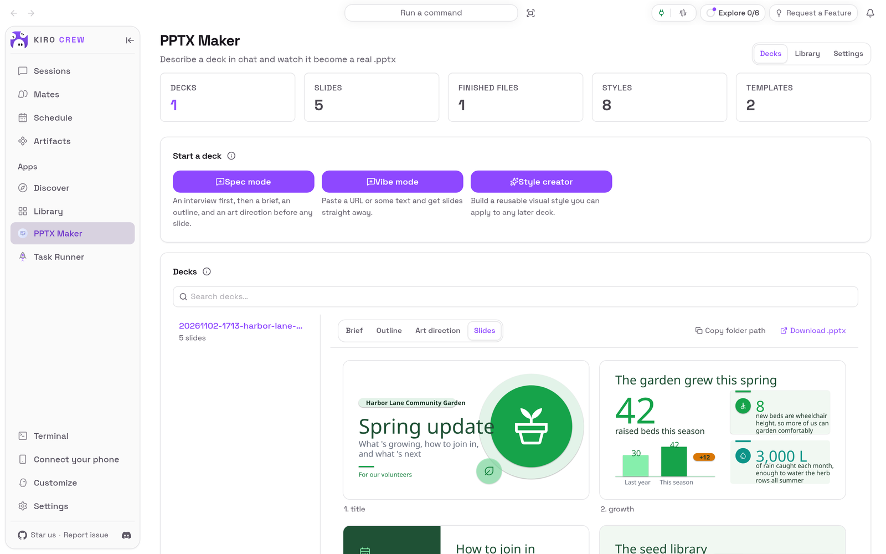

# PPTX Maker

<picture>
  <source media="(prefers-color-scheme: dark)" srcset="docs/media/hero-dark.png">
  
</picture>

**Describe the slides you want in a chat, and get a real PowerPoint file back.**

PPTX Maker is an app for [Kiro Crew](https://github.com/kirodotdev/KiroCrew),
the open-source personal AI agent.

## What it is

PPTX Maker adds a **PPTX Maker** page and four agents to Kiro Crew. From the page
you start a chat with one of them: **Vibe mode** turns your notes or a web page
into slides straight away, **Spec mode** first talks the deck through with you,
and **Style creator** designs a reusable look. While the agent works, the page
shows its plan (a brief, an outline, an art direction) and then each slide, and
when it is done you download the `.pptx`.

**Get started:** open **Apps → Library**, open the **⋯** menu on **PPTX Maker**
and choose **Enable**. [Install](#install) has the details.

## The problem it solves

A short update for your team or your volunteers still takes an evening: you
copy your notes into slides, pick colours, line up boxes, and fix the text that
spills over. Asking a chat assistant helps with the words, but you still build
the file yourself.

PPTX Maker hands the whole job to an agent that writes a real PowerPoint file
on your computer, using a free, open presentation engine. You keep the plan and
the slides in a folder you choose, and you can see each step before you open the
file. PPTX Maker itself uploads nothing: the agent uses the same AI model as the
rest of your Kiro Crew, and the file stays on your computer.

## Top 3 use cases

### 1. Turn your notes into a deck

You have a list of points for a volunteer meeting. On the PPTX Maker page choose
**Vibe mode**; a chat opens on the app's agent. Paste your notes, say what you
want (here: five slides, friendly, a fresh green look) and send. The agent plans
the deck, writes the slides and builds `output.pptx`, then lists what each slide
shows and offers next steps as buttons. In this run it also listed four friendly
lines it had added that were not in the notes, so they could be checked, and said
that it could not check the slides as pictures itself because a preview tool was
missing (see [Troubleshooting](#troubleshooting--faq)).

![A Vibe mode chat on the pptx-maker-vibe agent, set to Trust: the pasted garden notes are collapsed at the top, and the agent's reply says the five-slide deck is ready at its output.pptx path, that it could not look at the slides as pictures because the preview tool is missing on this machine, lists the five slides (Title, Growth, Saturdays, Seed library, What's next) with what each shows, says the look is light and green with garden icons and speaker notes, and lists four friendly lines it added that are not in the notes; buttons offer 'Looks good, I'm done', 'Remove the extra friendly lines' and 'Make the green brighter'](docs/media/use-case-vibe-light.png)

### 2. Check the plan before you open the file

Before it writes a single slide, the agent writes a brief, an outline and an art
direction. Pick the deck on the PPTX Maker page and switch between **Brief**,
**Outline**, **Art direction** and **Slides**. While a deck is being built the
viewer jumps to whichever part the agent just wrote, and each slide appears as
soon as it is composed. When you are happy, choose **Download .pptx**.

![The Harbor Lane deck on its Outline tab: five lines, one per slide, from [title] 'Volunteers feel welcomed and know this is the Harbor Lane Community Garden spring update' to [next-goals] 'Volunteers are excited about what's next (compost class 14 May, shade pergola by June) and know where to ask questions'](docs/media/use-case-outline-light.png)

### 3. Give the same content a different look

Open **Library**. **Styles** set the mood (colours, type, layout feel) and
**Templates** are `.pptx` files whose layouts and theme colours the agent
follows. Pick one to preview it; the page shows a token such as
`[Style: elegant-light]`. Paste that token into your chat and the agent uses that
style. **Import a style** takes your own `.html` style document and **Import a
template** your own `.pptx`.

![The Library view on Styles: the eight bundled styles (border, corporate-executive, cute-playful, elegant-dark, elegant-light, flat-shadow, lumina, tech-cyber) with thumbnails, elegant-light selected, the line 'Reference it in chat as [Style: elegant-light]', and its cover slide 'ELEGANT LIGHT' previewed on the right](docs/media/use-case-style-light.png)

## Watch it

![A walkthrough of PPTX Maker: the Harbor Lane deck on the Slides tab, scrolling through the green slides; the Brief, Outline and Art direction tabs; pointing at Download .pptx; the Library with the elegant-light style and its [Style: elegant-light] token; the Templates list with blank-dark; and finally Vibe mode, which opens a new chat on the pptx-maker-vibe agent](docs/media/walkthrough.gif)

[Watch the walkthrough as a video (MP4)](docs/media/walkthrough.mp4).

<sub>Recorded from a real Kiro Crew dashboard (Kiro Crew `99161724c0`, with
this repository installed into a throwaway home in place of the copy that comes
with Kiro Crew) with a made-up deck about a community garden. The deck and the
chat reply in use case 1 come from a live AI model and will vary; LibreOffice was
installed so the page could draw the slides. The walkthrough sends no chat
message.</sub>

## Install

**Today: PPTX Maker comes with Kiro Crew.** Nothing needs downloading. It starts
switched off:

1. In Kiro Crew, open **Apps → Library** in the left sidebar.
2. Choose **Show N disabled apps** (N is how many apps are switched off).
3. On the **PPTX Maker** tile, open the **⋯** menu and choose **Enable**.
4. **PPTX Maker** now appears under **Apps** in the sidebar.

The copy that comes with Kiro Crew can reveal a deck's folder in your file
manager; this repository's copy, pictured here, copies the folder's path instead,
offers the icon packs on the page, and tells its agents how to build the slides
in Kiro Crew (see [Development](#development)).

**Coming later: from the Kiro Crew App Store.** Once this app is listed there:

1. Open **Apps → Discover** in the left sidebar.
2. Search for **PPTX Maker** and choose **Install**.
3. Kiro Crew asks **Trust “PPTX Maker” to run its own code?** PPTX Maker runs a
   small program of its own inside Kiro Crew to install the presentation engine,
   read your decks and manage your styles. Trusting it gives that program the
   same access Kiro Crew has (your files, your saved sign-ins and the internet),
   as the dialog says. If you are happy with that, choose **Trust this app**. You
   can take it back later in **Settings → Security → Third-party apps**.
4. The app installs switched off. Choose **Enable** on its page.

What you need: Kiro Crew on a Mac, Linux or Windows computer, and Kiro Crew must
already be able to chat. The engine and the icon packs are downloaded from the
internet the first time (see [First run](#first-run)); the icon packs need `git`.
To see the slides drawn on the page, install LibreOffice (free); without it the
`.pptx` is still built, but the **Slides** tab shows empty frames. No accounts or
keys are needed.

## First run

Open **PPTX Maker** from the sidebar. A note says **The presentation engine is
not installed yet.** Choose **Install engine** and wait: PPTX Maker downloads a
checked copy of the engine and the parts it needs (this takes a minute or two the
first time). Then a second note says **The icon packs are not installed yet.**
Choose **Install icon packs** (about 40 MB); the agent cannot compose slides
without them. If LibreOffice is missing, a line under the title says so.

Restart Kiro Crew once after the first install (or switch the app off and on in
**Apps → Library**), so the agents can use the slide-preview tool PPTX Maker has
just installed.

## How to use it

1. **Start a deck.** On the PPTX Maker page choose **Vibe mode** (paste a web
   address or some text and get slides straight away), **Spec mode** (the agent
   asks you about the deck first, then writes a brief, an outline and an art
   direction before any slide) or **Style creator** (build a reusable style).
   A new chat opens on that mode's agent.
2. **Let it work.** Type your request and send. The agent asks before each step
   that writes files. To let it work without asking in this chat, open the
   approval menu under the message box (it says **Normal**) and choose **Trust**.
   Otherwise choose **Approve** on each request.
3. **Watch it.** Go back to **PPTX Maker**. The new deck is in **Decks**; the
   viewer follows the part the agent just wrote: **Brief**, **Outline**, **Art
   direction**, then **Slides**. **Search decks…** filters the list.
4. **Get the file.** Choose **Download .pptx**. **Copy folder path** copies where
   the deck's files are, to open them yourself.
5. **Change it.** Ask in the same chat ("make the green brighter", "shorten slide
   3"), or use the buttons the agent offers.
6. **Reuse a look.** In **Library**, pick a style or template and paste its token
   (`[Style: …]` or `[Template: …]`) into a chat. The pin button makes a style
   the default; your own styles and templates can be renamed and deleted.
7. **Choose where decks go.** **Settings → Deck output directory**, then
   **Save**.

## Settings & data

- **Where your data lives:** decks are folders in the **Deck output directory**
  (`~/.config/sdpm/decks` unless you change it, or `~/Documents/SDPM-Presentations`
  if you used the engine before). Your styles, templates and the engine's settings
  are in `~/.config/sdpm/`. The engine itself is in
  `~/.kiro/crew/apps/pptx-maker/data/` (or in the same place under the folder you
  chose for Kiro Crew's data, if you moved it).
- **What goes over the internet:** **Install engine** downloads the
  spec-driven-presentation-maker engine from GitHub at a fixed version, and PPTX
  Maker refuses it unless it matches a fixed fingerprint; the engine's Python
  parts come from the Python Package Index. **Install icon packs** downloads the
  AWS architecture icons and Google's Material Symbols. When you give the agent a
  web address, it reads that page. Chats use the same AI model as the rest of
  your Kiro Crew. Your decks are not uploaded by PPTX Maker.
- **Who can use it:** anyone using this Kiro Crew can view the decks, but only
  the person who set it up can install the engine, change the deck folder or the
  library.
- **Turn it off:** **Apps → Library**, open the **⋯** menu on PPTX Maker, choose
  **Disable**. Your decks, styles and the engine are kept.
- **Remove it** (once it is installed from the App Store): the same menu,
  **Uninstall**. **Keep app data** is ticked; untick it to delete the engine too.
  Your decks and styles are in your own folders and are never deleted.

## Troubleshooting / FAQ

**The Slides tab shows empty frames.**
Install LibreOffice: the slides are drawn from the `.pptx` by LibreOffice. The
file itself is fine; download it.

**The agent says its preview tool is missing.**
Restart Kiro Crew (or switch PPTX Maker off and on) once after installing the
engine for the first time, so the agents see the tool. The deck is still built.

**The agent says its slide tool went offline, and stops after the outline.**
The icon packs are not installed. Choose **Install icon packs** on the PPTX Maker
page, wait for it to finish, then ask the agent in the same chat to build the
slides.

**The engine will not install.**
Check that this computer can reach github.com and pypi.org, then choose **Try the
install again**. A download that does not match the fixed fingerprint is refused
on purpose.

**A request is refused, saying only the owner may do it.**
You are using a Kiro Crew someone else set up. Only its owner can install the
engine or change the library and the deck folder.

**"that deck folder is not a usable path".**
The folder cannot be used, or it is (or contains) a folder that holds your
sign-ins, such as your home folder itself. Pick a folder of its own.

## Development

This repository is the externally packaged form of the `pptx-maker` app that
ships built into Kiro Crew. The two share a name, a version and the same
permissions and agents, so the Kiro Crew release that adds built-in adoption can
move an existing built-in install onto this source in place, at a commit pinned
in that release: the engine, the decks and the library stay where they are.
Until a user's Kiro Crew does that, it keeps running its built-in copy, and
nothing here changes what they run. [PORTING.md](PORTING.md) lists every place
this copy differs from the built-in and why, and every gap that still needs a
Kiro Crew change.

| Path | What it is |
|---|---|
| `app.json` | The app manifest, including the four agents, the skill, the `ui` entry and the `l10n` listing copy |
| `agents/` | The four agent templates (Spec, Vibe, Composer, Style); the gateway fills in their runtime paths |
| `prompts/spec-studio.md` | The app's own guidance for the agents, read beside the engine's prompts |
| `skills/pptx-maker` | The skill that points a general chat at the app |
| `backend/routes.py` | The in-gateway routes (`backend.hooks.routes`); changes are owner-gated |
| `backend/paths.py` | Every path from the browser, contained to the deck and library folders |
| `backend/decks.py`, `library.py` | Reading decks; the style and template library |
| `backend/engine_source.py`, `provision.py`, `engine.py` | The sha256-pinned engine download, its `uv` build and the sandboxed engine calls |
| `backend/preview_tools.py`, `pdftoppm_shim.py` | The managed `pdftoppm` stand-in |
| `backend/_host.py` | The only module that touches the gateway |
| `backend/_compat.py`, `_fs.py`, `_os_deps.py` | Small helpers restated from Kiro Crew |
| `ui/src/` | The dashboard page (React), built against `@kirocrew/app-sdk` |
| `ui/i18n/` | The page's strings in every language the dashboard ships |
| `ui/dist/index.mjs` | The built page, **committed**: an install is a plain clone with no build step |
| `ui/tests/` | UI tests (vitest + jsdom), with light stand-ins for the host SDK |
| `assets/` | Store icon, hero art and screenshot (raster, as the catalog requires) |
| `tests/` | Backend and manifest tests, runnable offline with pytest |
| `capture/` | Captures the README media from a real, isolated Kiro Crew ([capture/README.md](capture/README.md)) |
| `docs/media/` | The README pictures and walkthrough, plus `media.json` (sizes, alt text, commits) |

### What it needs from Kiro Crew

Kiro Crew 0.12.0 or later (`minKiroCrewVersion`): App Kit level 1, which gives an
app's hooks an owner gate (`ctx.require_owner`) and structural route records, and
gives its page `guideCaution`. PPTX Maker also uses `ctx.scrub` (redaction of
everything agent-written it serves), `ctx.audit` (the security event log) and
`ctx.data_dir`.

The engine and `uv` must run inside Kiro Crew's sandbox, the engine download must
go through Kiro Crew's verified downloader, and every deck path and file through
its sensitive-path gate and pinned reader; no App Kit seam offers those yet.
`backend/_host.py` therefore looks them up in the gateway by name at the moment
it needs them, and when one is missing it refuses the operation instead of
running it unprotected; `register_routes` reports what is missing through the
app's health. No other backend module names `kiro_crew`
(`tests/test_no_host_imports.py`).

The agent templates carry only the host placeholders Kiro Crew computes for every
app: `{APP_ROOT}`, `{APP_DATA}`, `{UV_BIN}`, `{HOST_PATH}` and `{PATH_SEP}`. The
gateway fills them in itself when it registers the agents. `backend/provision.py`
states the contract (`PLACEHOLDERS`, `render_agent_template`), and the tests pin
it.

### Install from a clone

```bash
git clone https://github.com/KiroCrewCaptain/kirocrew-app-pptx-maker
kirocrew app install ./kirocrew-app-pptx-maker
```

Then turn it on from **Apps → Library**. The app runs its own code
(`backend.hooks` in `app.json`), so Kiro Crew will not enable it until you trust
it: the Library's **Enable** opens **Trust “PPTX Maker” to run its own code?**,
and **Trust this app and enable** does both. Until it is trusted,
`kirocrew app enable pptx-maker` is refused with `app_execution_denied`; there is
no command-line trust step.

While your Kiro Crew still has the built-in copy installed, the install itself is
refused: `app 'pptx-maker' is already installed`. From a terminal,
`kirocrew app disable pptx-maker` turns the app off, and
`kirocrew app uninstall pptx-maker` (add `--purge-data` to delete the engine)
removes an installed copy.

### Tests

Backend and manifest:

```bash
python -m pip install -r tests/requirements.txt
python -m pytest
python -m flake8 backend tests
```

These need neither Kiro Crew nor the network. `tests/fakehost.py` stands in for
the gateway (its sandbox runs the argv unwrapped, its path gate knows a few
names, its redaction knows the credential shapes the tests use) and for the app
context; `tests/harness.py` serves the routes the way the gateway's route
registry does.

UI (Node 24, from `ui/`):

```bash
npm ci
npm run typecheck
npm test
npm run build
```

`npm run build` writes `ui/dist/index.mjs`. Commit it with the source change that
produced it: CI rebuilds it from a clean `npm ci` and fails if the result differs.
The bundle imports only the modules the dashboard provides, plus DOMPurify, which
it bundles; `tests/test_manifest_contract.py` checks that, and that every name it
imports by name exists on a Kiro Crew without the level-1 seams. A UI string goes
into `ui/i18n/en.json` and every other catalog there.

### Re-capture the README media

The pictures and the recording come from a real, isolated Kiro Crew gateway
driven by [`capture/`](capture/README.md). While Kiro Crew still ships the
built-in PPTX Maker, the gateway's checkout must stop it registering (take
`pptx_maker` out of `BUILTIN_NAMES`, delete
`src/kiro_crew/apps/builtins/pptx_maker/app.json` and
`src/kiro_crew/builtin_skills/pptx-maker`) while keeping its Python package, so
that this repository is the copy installed and its agents still render. Run from
a clean clone so the install copies no `node_modules`, with LibreOffice's
`soffice` on `PATH` and `XDG_CONFIG_HOME` pointed at a scratch folder (the engine
keeps its settings and the demo decks there, never in your own). The chat scene
is live, so run it first: the other scenes show the deck it writes.

```bash
git clone . /tmp/pptx-clean && cd /tmp/pptx-clean
export XDG_CONFIG_HOME=/tmp/pptx-maker-demo/xdg
python capture/capture.py --kirocrew /path/to/that/KiroCrew --out /path/to/this/repo/docs/media --only screenshots --shot use-case-vibe
python capture/capture.py --kirocrew /path/to/that/KiroCrew --out /path/to/this/repo/docs/media --shot hero --shot use-case-outline --shot use-case-style
python capture/check_readme.py /path/to/this/repo/README.md
```

Then look at every image and at a few frames of the video before committing
(see [CHECKLIST.md](CHECKLIST.md)).

## License

MIT No Attribution (MIT-0). See [LICENSE](LICENSE) and [NOTICE](NOTICE). PPTX
Maker is ported from the PPTX Maker app by sktok; see
[ATTRIBUTION.md](ATTRIBUTION.md).
